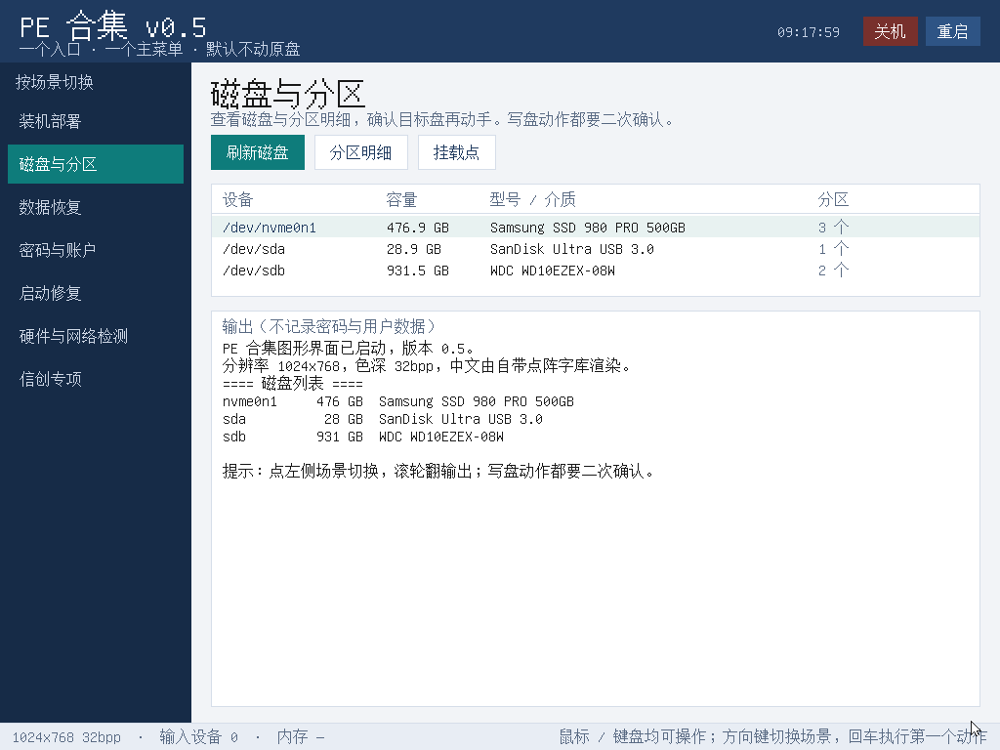

# Linux PE

自研的可引导 Linux PE，插盘开机即用，**有图形界面，中文不是方块**。
本仓库只做一件事：**发布镜像产物**。源码在私有开发仓，不在这里。



> 上图是构建流程里真实渲染出来的一帧（framebuffer 自绘，不是效果图）。
> 中文全部来自镜像内自带的点阵字库，不依赖系统里装了什么字体。

## 下载

去 [Releases](../../releases/latest) 拿最新的 `pe-bootable-vX.Y.iso` 和 `SHA256SUMS`：

```bash
sha256sum -c SHA256SUMS
```

## 写盘

**UEFI 启动**，用下面任一方式：

```bash
# Linux / macOS：先确认盘，别写错
lsblk
sudo dd if=pe-bootable-vX.Y.iso of=/dev/sdX bs=4M status=progress oflag=sync
```

- Windows：Rufus 选这个 ISO，分区类型 GPT、目标系统 UEFI，**不要**用 ISO 模式以外的花样
- balenaEtcher 也可以，直接选 ISO

写错了盘不可逆，动手前先 `lsblk` / 磁盘管理里核对容量和型号。

## 里面有什么

启动后直接进图形界面，左侧按场景切换，全部点选，不用敲命令：

| 场景 | 能干什么 |
| --- | --- |
| 装机部署 | 装系统前看清磁盘、固件模式（UEFI/BIOS）、引导现状 |
| 磁盘与分区 | 磁盘 / 分区 / 卷只读枚举，分区表类型、容量、挂载点 |
| 数据恢复 | 坏盘先做只读镜像的完整流程，写盘类操作一律二次确认 |
| 密码与账户 | 离线重置 Linux 账户密码（chntpw 路线另说） |
| 启动修复 | 麒麟 / 统信 UOS 的 grub 修复，先备份再修，修坏了能退 |
| 硬件与网络检测 | CPU、内存、磁盘、网卡、固件模式一次看全 |
| 信创专项 | 识别麒麟 / 统信环境与版本，给出对应处置建议 |

设计取向是**保守**：只读优先，写盘必须二次确认，拿不准的操作只打印命令给你看、不替你执行。
现场点错一个盘的代价不可逆，这个 PE 宁可少做一步。

## 这里面没有 Windows PE

本仓库只涉及 Linux 线。Windows PE 不在这个仓库，也不会出现在任何 Release 里——
微软 WinPE 的授权允许内部部署与恢复使用，但**不允许再分发**，
把含 `boot.wim` 的镜像公开出去就是违规。这不是技术限制，是许可边界。

## 源码与许可

- **自研部分**（init、图形框架、场景逻辑、工具编排）是本项目的独立作品，
  源码不随产物发布，也不在本仓库。
- **镜像内含的第三方组件**（busybox、python3、Linux 内核等）按各自的许可证分发，
  其中 GPL/LGPL 组件的**对应源码获取方式**写在每个 Release 附带的 `sources-vX.Y.tar.gz` 里：
  组件名、精确版本、许可证、上游源码地址、以及用哪个发行版源码包能取到同一份代码。
  我们对这些组件**没有打补丁**，用的就是发行版原样二进制。
- 本仓库内的文档与截图：[CC BY 4.0](LICENSE)。

如果 `sources` 包里缺了你需要的东西，开 issue 说清楚要哪个组件，我补。

## 已知限制

- 只在 UEFI 下验证；Legacy BIOS 没做。
- 界面不做文本输入框：PE 环境没有中文输入法，敲中文路径是坑，所有选择都做成点选。
- 图形界面起不来时会自动降级到英文文字菜单，再不行进命令行——不会黑屏，也不会满屏方块。
- 硬件兼容性靠实测积累，遇到起不来的机器请带上机型、显卡、日志（`/var/log/pe-*`）开 issue。

## 版本

见 [Releases](../../releases)。版本号形如 `v0.5`，每个版本附 `SHA256SUMS` 与源码说明包。
